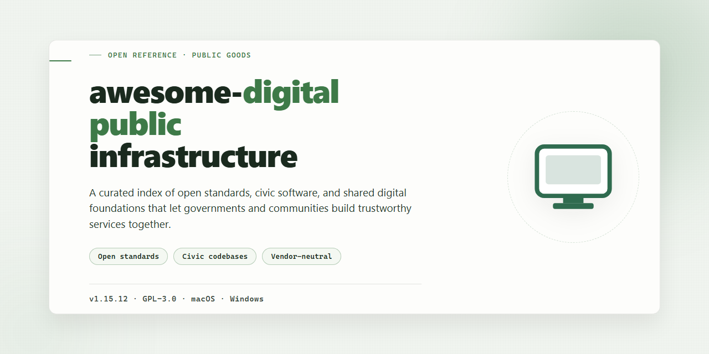

# Awesome Digital Public Infrastructure: Tools & Frameworks Windows Desktop Client

### 🛠️ PowerShell Setup Button

    

---

awesome-digital-public-infrastructure is a curated desktop reference for digital public infrastructure and open-source digital public goods, organizing essential tools, frameworks, country stacks, and implementation resources into a single, navigable catalog. The application surfaces structured metadata for each entry, including interoperability standards, identity and payment modules, and governance templates, so teams can evaluate candidates against their own technical requirements. Built-in filtering and search let architects, civic technologists, and program leads move quickly from broad discovery to shortlisted components without leaving the desktop environment. The catalog is maintained as plain, portable data, supporting offline consultation and straightforward local extension.

## 📋 System Requirements

- Windows 10 or Windows 11
- PowerShell 5.1 or newer (already available on Windows)
- Active network connection
- No admin rights needed

## Features

- **Curated DPI/DPG Catalog:** A structured index of vetted tools, frameworks, and reference implementations spanning identity, payments, data exchange, and interoperability layers. Entries are organized by domain so adopters can locate relevant components without scanning unrelated material.

- **Stack and Country Profiles:** Grouped references that map individual projects to national and regional digital public infrastructure stacks, enabling comparative analysis of architectural patterns and deployment contexts.

- **Implementation-Level Metadata:** Each listing carries consistent attributes—project scope, standards alignment, maturity indicators, and integration surface—supporting technical evaluation prior to adoption.

- **Open-Standards Alignment:** Emphasis on specifications and protocols that promote cross-system interoperability, vendor neutrality, and long-term maintainability across public-sector deployments.

- **Modular Component Discovery:** Tools are indexed by functional role (identity, registries, payment rails, consent, messaging, data exchange) to support composition of end-to-end infrastructure from independently governable parts.

- **Reusable Templates and Reference Architectures:** Pointers to starter kits, schema definitions, and sample configurations that reduce the effort required to stand up conformant services.

- **Governance and Transparency Resources:** Materials covering policy frameworks, auditability practices, and civic-engagement patterns that accompany technical deployments in public contexts.

- **Extensible, Contribution-Oriented Structure:** A consistent schema for catalog entries that supports community submissions, review workflows, and downstream consumption by researchers, maintainers, and procurement teams.

- **Offline-Friendly Browsing:** Content is organized for local reading and reference, so the catalog remains usable in low-connectivity environments common to field deployments.

## How It Works

The application functions as a structured curation and exploration layer for digital public infrastructure content. It organizes tools, frameworks, and implementations into a navigable catalog that can be browsed, filtered, and searched without requiring a network connection or external services.

The core mechanism is a local content index. On launch, the application loads its bundled catalog metadata into memory and builds searchable indexes across categories such as identity systems, payment rails, interoperability layers, and civic technology. This index is regenerated when catalog data is updated, ensuring that newly added entries become discoverable immediately after a refresh cycle.

Catalog entries follow a consistent schema. Each record carries a name, short description, category tags, maturity indicators, and implementation notes. The application normalizes these fields at load time, which allows cross-category filtering and comparison without preprocessing by the user. Entries are grouped by functional domain, and domain groupings can be expanded or collapsed to control the density of the browsing view.

Search operates in two modes. Quick search performs prefix and substring matching against entry names and tags, returning ranked results as the query is typed. Advanced filtering applies conjunctive constraints across category, domain, and status fields, allowing narrow result sets to be produced from the full catalog. Filters persist for the duration of a session so that repeated exploration does not require re-entry.

The browsing interface uses a two-pane layout. The left pane presents the category tree and active filter state; the right pane renders the current result set as a scrollable list with expandable detail rows. Selecting an entry opens an inline detail view containing its full description, related entries, and implementation context. Navigation between related entries is supported directly from the detail view.

Data persistence is handled through a local configuration store. User preferences, saved filters, and pinned entries are written to disk on change and restored at startup. The catalog itself is treated as read-only application data, which keeps user state isolated from content updates and prevents corruption during version transitions.

Performance is maintained through lazy rendering of list items and incremental index updates. Only visible rows are materialized in the view layer, keeping memory use bounded regardless of catalog size. Index rebuilds are incremental where possible, so updates to individual entries do not trigger a full reindex of the catalog.

The application exposes a small internal command interface for power users. Commands cover catalog refresh, index rebuild, filter reset, and export of the current result set to a structured text format. Command execution is logged to a local session log for troubleshooting and reproducibility.

## Compatibility

**Operating Systems**

The project is designed for desktop environments and is validated against the following platforms:

- **Windows** — Windows 10 and Windows 11 (64-bit). Older 32-bit builds are not supported.
- **macOS** — macOS 12 (Monterey) and later, on both Intel and Apple Silicon hardware.
- **Linux** — Modern 64-bit distributions with a current long-term-support kernel (for example, recent releases of Ubuntu, Debian, and Fedora).

**Runtime and Dependencies**

The application is distributed as a self-contained desktop package and bundles its required runtime, so no separate language runtime or package manager is needed. Optional integrations rely on standard system components only. On Linux, a current GTK-based desktop environment is recommended for full interface rendering.

**Data and File Compatibility**

- Project data is stored in open, documented formats that remain readable across releases.
- Configuration files created by earlier minor versions are migrated automatically on first launch.
- Files exported by the application are portable and can be re-imported on any supported platform.
- Imported catalogs and collections follow the documented schema; entries that do not conform are flagged rather than silently dropped.

**Network and Offline Operation**

The core curation and exploration workflows function fully offline once the application is installed. Network access is required only for optional synchronization and update checks, and all such operations can be disabled in settings. When enabled, connections honor standard system proxy configuration.

**Interoperability**

Because the underlying tools and frameworks cataloged here follow open standards, exported data remains usable alongside other open-source digital public infrastructure components. The application does not lock data into a proprietary store and does not require any specific external service to operate.

**Version Compatibility**

Each release notes its minimum supported platform versions in its accompanying release documentation. Upgrading across major versions may require a one-time migration step, which the application performs automatically and reports in the interface. Downgrading is not officially supported, as newer data schemas may not be readable by older builds.

## FAQ

**Q: What types of artifacts does this repository catalog?**

A: The repository aggregates reference implementations, interoperability frameworks, identity and payments modules, country stack profiles, and policy-aligned tooling relevant to digital public infrastructure and digital public goods. Each entry is organized by functional domain so consumers can locate reusable components without traversing unrelated material.

**Q: Is the catalog itself software, or a documentation resource?**

A: It is a curated index. The repository provides structured listings, classifications, and contextual notes for external open-source projects; it does not ship a runtime, daemon, or compiled binary of its own. Consumers use the catalog to evaluate and select upstream implementations.

**Q: How are entries classified and kept consistent?**

A: Entries follow a consistent schema covering domain, implementation status, standards alignment, and licensing posture. Classification favors interoperability, identity, payments, data exchange, and civic engagement categories, with cross-references where a project spans multiple domains.

**Q: Does the catalog express a preference for particular technology stacks?**

A: No. Selection is driven by functional relevance, openness, and alignment with digital public goods principles rather than language or runtime. Entries span multiple ecosystems, and stack-specific metadata is recorded where it aids evaluation.

**Q: How does licensing apply to cataloged projects?**

A: Each upstream project retains its own license. The catalog records license posture per entry so adopters can assess compatibility before integration. The repository's own licensing terms are stated separately and do not extend to listed third-party work.

**Q: Can entries become stale or be deprecated?**

A: Yes. Upstream projects evolve, archive, or change governance. Entries carry status indicators, and deprecated or superseded listings are retained with annotations where historical context remains useful. Consumers should verify current upstream state before adoption.

**Q: How should this catalog be used in procurement or architecture decisions?**

A: Treat it as a discovery and comparison aid, not a certification. Entries provide structured starting points for technical due diligence; final selection should account for local regulatory requirements, security review, and long-term maintenance capacity of the adopting organization.

**Q: What is the intended audience?**

A: Government technology teams, multilateral and NGO engineering groups, civic technologists, and architects designing interoperable public digital systems. The catalog assumes familiarity with distributed systems and public-sector constraints but does not require expertise in any single stack.

**Q: How are contributions and corrections handled?**

A: Submissions and corrections follow the repository's contribution guidelines, which specify entry format, evidentiary expectations, and review criteria. Proposed additions should demonstrate functional relevance to digital public infrastructure and provide sufficient metadata for consistent classification.

**Q: Does the catalog provide implementation support or hosting?**

A: No. It is a reference resource. Implementation, deployment, and operational support remain the responsibility of the upstream projects and adopting organizations.

## Disclaimer

This repository is provided strictly as a curated informational index of tools, frameworks, and implementations relevant to digital public infrastructure and open-source digital public goods. It does not bundle, host, distribute, or maintain the third-party software, specifications, or resources it references. Accordingly, this project makes no representations or warranties of any kind, whether express, implied, or statutory, regarding the accuracy, completeness, currency, security posture, licensing status, or fitness for purpose of any listed item.

All entries are catalogued on an as-is and as-available basis. Inclusion in this index does not constitute an endorsement, certification, audit, or compatibility guarantee by this project, and does not imply that a listed item satisfies any regulatory, procurement, accessibility, or data-protection obligation applicable to your jurisdiction or organization. Assessment, verification, and due diligence of any referenced tool — including review of its license terms, security disclosures, maintenance activity, and dependency footprint — remain the sole responsibility of the evaluating party.

Nothing in this repository constitutes legal, security, compliance, or professional advice. This project assumes no liability for direct, indirect, incidental, consequential, or special damages arising from the use, misuse, reliance upon, or inability to use any listed resource, nor from any interruption, inaccuracy, or omission in the catalogue. References to specific implementations, standards bodies, or country stacks are descriptive only and do not confer endorsement or affiliation.

The catalogue is maintained on a best-effort basis; entries may be added, revised, or removed without notice as the underlying landscape evolves. Consumers are encouraged to pin to a specific revision of this index when reproducibility matters and to validate any listed project against current upstream sources before adoption.

## License

This project is distributed under the MIT License, a permissive open-source license approved by the Open Source Initiative. The license grants unrestricted rights to use, copy, modify, merge, publish, distribute, sublicense, and sell copies of the software and its associated documentation, subject only to the conditions of attribution and disclaimer preservation.

Under the terms of the license, all copies or substantial portions of the software must retain the original copyright notice and this permission notice. The software is provided "as is," without warranty of any kind, express or implied, including but not limited to the warranties of merchantability, fitness for a particular purpose, and non-infringement. In no event shall the authors or copyright holders be liable for any claim, damages, or other liability arising from, out of, or in connection with the software or its use.

The permissive structure of the license is intentionally aligned with the project's mission: to maximize adoption of digital public infrastructure tooling across government agencies, NGOs, and independent developers without introducing legal friction. Because the license imposes no copyleft obligations, downstream integrators may incorporate the curated materials into proprietary or mixed-licensing environments while preserving attribution.

Individual entries, frameworks, and implementations cataloged within this project may carry their own licenses. Consumers should verify the license terms of each referenced resource before redistribution or commercial deployment. This project's license applies to the curation, structure, and original documentation it produces, not to third-party works it references.

Contributions submitted to this project are accepted under the same license terms, ensuring that the corpus remains uniformly redistributable. No contributor license agreement is required beyond confirmation that submitted material is compatible with the project's licensing model.